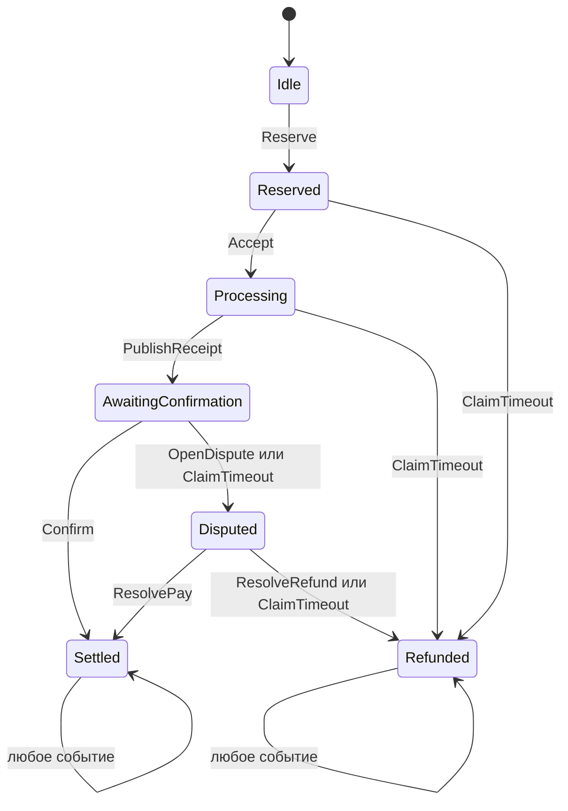
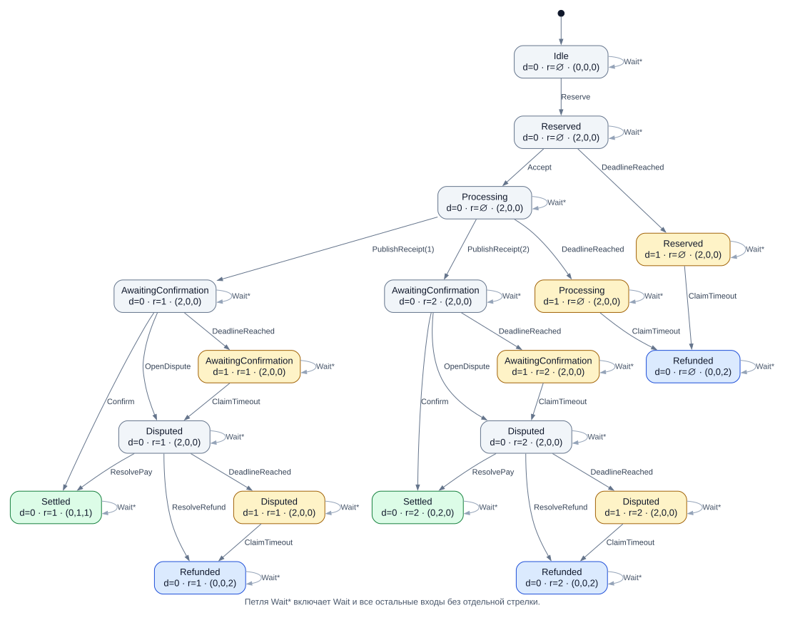
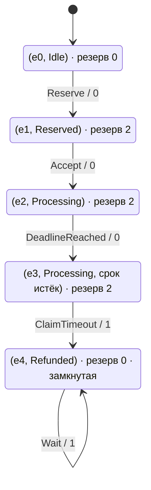
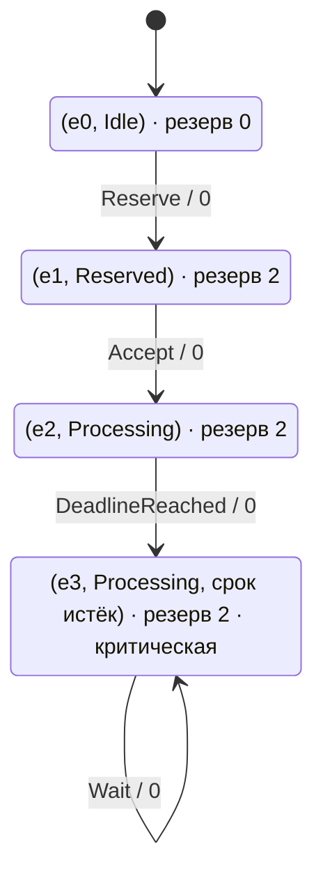
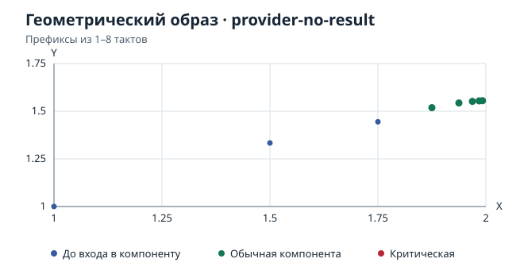
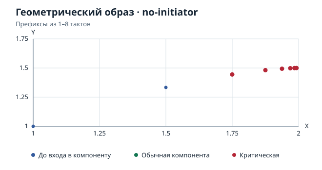
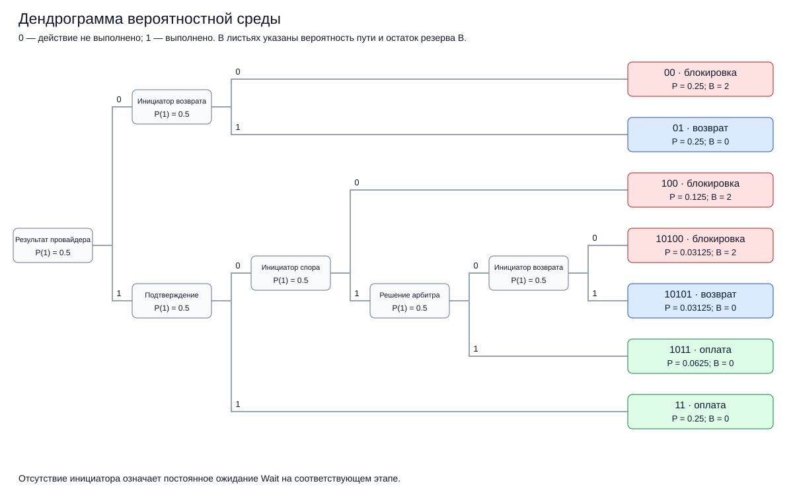

# Автоматная модель смарт-контракта оплаты запросов к нейросетевому сервису

## 1. Постановка задачи

В работе рассматривается контракт оплаты одного запроса к языковой модели. Пользователь резервирует средства, провайдер выполняет запрос, после чего стороны завершают расчёт либо разрешают спор. На результат влияют действия участников, задержки и доступность операций завершения.

Контракт представляется детерминированным автоматом, а внешняя среда — управляющим автоматом. Их совместное поведение исследуется с помощью сплетения автоматов и анализа минимальных подавтоматов [1].

**Цель:** определить условия завершения расчётов и найти сценарии, приводящие систему в замкнутую область поведения с заблокированными средствами.

Задачи работы:

1. Формализовать правила контракта и ограничения конечной модели.
2. Построить детерминированный автомат-определитель, затем автоматы Мура и Мили.
3. Описать управляющие автоматы среды и их сплетение с контрактом.
4. Исследовать достижимость, замкнутые компоненты, денежные инварианты и условия завершения.
5. Построить геометрические образы и сопоставить изображения с результатами анализа графов.
6. Реализовать модель и анализатор на C# и провести эксперименты с различными сценариями среды.
7. Задать вероятностную среду, вычислить вероятности исходов и построить дендрограмму путей.

## 2. Предметная область

Платные нейросетевые сервисы связывают оплату с запросами, ответами и учётом использования. В системе 0G Compute [5], например, используются счета провайдеров и отложенные пакетные расчёты за запросы.

Рассматриваемый контракт задаёт расчёт для одного запроса: резервирование максимальной стоимости, публикацию квитанции, подтверждение результата, арбитраж и возврат средств по истечении срока.

Публикация ответа и его получение пользователем могут происходить в разное время. Сообщения могут задерживаться или поступать повторно, а участники — прекращать взаимодействие. Анализ этих ситуаций позволяет определить условия завершения расчётов и возникновения блокировок.

## 3. Границы и участники модели

### 3.1. Участники

| Участник | Действия и ответственность |
| --- | --- |
| Пользователь | Резервирует оплату, подтверждает получение результата или открывает спор |
| Провайдер | Принимает и выполняет запрос, публикует квитанцию о результате |
| Арбитр | По заданным правилам рассматривает спор и выбирает оплату либо возврат |
| Инициатор завершения | Любой участник или внешний наблюдатель, вызывающий разрешённое действие после истечения срока |
| Источник времени | Формирует достоверное событие достижения срока; не распоряжается средствами |

Инициатором завершения может быть любой участник или внешний наблюдатель. В сценариях среды отдельно задаётся, вызывает ли он разрешённую операцию.

### 3.2. Допущения модели

- Рассматривается один запрос между фиксированными пользователем и провайдером; арбитр выбирается до резервирования.
- Фиксируются идентификатор запроса, модель и правила расчёта. Параллельные запросы и смена провайдера остаются за границами первой версии.
- В предполагаемой схеме провайдер вычисляет ответ на своём сервере и передаёт его пользователю. Блокчейн служит средой исполнения контракта, который управляет резервом, оплатой и возвратом. Приложение на C# моделирует обработку вызовов и порядок их поступления, а движение средств представлено изменениями состояния автомата.
- Ответ рассматривается как единый результат. Это допущение касается выдачи ответа пользователю. Бинарный выход автомата показывает завершённость расчёта (раздел 5.4).
- Деньги учитываются в целых условных единицах, чтобы точно вычислять оплату, остаток и возврат. Признак достаточности средств одинаков для платежей стоимостью 1 и 2 при резерве 2, хотя остатки в этих случаях различаются. Числовые суммы позволяют проверить распределение всего резерва.
- Подпись и соответствие идентификаторов и хешей представлены признаками проверки. Объём токенов и стоимость хранятся как числа и участвуют в расчёте.
- Допустимый вердикт уполномоченного арбитра принимается как основание для расчёта. Отсутствие вердикта к сроку обрабатывается по общим правилам раздела 4.2 и проверяется в сценарии `arbiter-offline`.
- Локальный сценарий подаёт автомату событие `PublishReceipt` с заранее заданной квитанцией. Так воспроизводится обработка публикации квитанции провайдером. Генерация текста ответа остаётся вне модели.

## 4. Спецификация расчётов

### 4.1. Бюджет и квитанция

До начала исполнения стороны фиксируют цену одного токена `p > 0`, максимальное суммарное число входных и выходных токенов `U > 0` и идентификатор модели с правилами токенизации. Для простоты используется единая цена входных и выходных токенов.

Пользователь резервирует максимальную стоимость:

$$
R = pU.
$$

Квитанция провайдера содержит идентификатор запроса, идентификатор модели, хеш согласованных условий, хеш запроса, хеш ответа, заявленный объём `u` и стоимость `C`. Допустимы значения:

$$
1 \leq u \leq U, \qquad C = pu \leq R.
$$

Квитанция должна соответствовать текущему запросу и согласованным условиям и иметь допустимое подтверждение авторства провайдера. Несоответствие объёма, стоимости, идентификаторов или подтверждения авторства делает событие недопустимым.

При оплате `C` перечисляется провайдеру, а `R - C` возвращается пользователю. При полном возврате пользователь получает `R`, провайдер — `0`. В первой версии нет частичного удовлетворения спора и залога провайдера.

Подпись используется для проверки авторства квитанции. Пользователь подтверждает получение ответа и принимает заявленный объём использования либо открывает спор. При споре решение о расчёте принимает арбитр. Проверка содержания ответа и фактического числа токенов относится к процедуре арбитража; в автомат поступает готовый вердикт.

### 4.2. Правила завершения

1. Резервирование открывает срок принятия запроса провайдером.
2. Принятие до истечения срока открывает срок выполнения запроса.
3. Публикация допустимой квитанции до истечения срока выполнения открывает срок подтверждения пользователем.
4. Подтверждение квитанции пользователем в пределах срока завершает расчёт оплатой.
5. Пользователь может открыть спор в пределах срока подтверждения. При отсутствии подтверждения после срока инициатор может отдельно передать расчёт арбитру через `ClaimTimeout`.
6. Передача расчёта арбитру запускает срок арбитража. До его истечения арбитр выбирает оплату по квитанции либо полный возврат.
7. После истечения срока принятия, выполнения или арбитража любой инициатор может отдельным действием выполнить полный возврат.
8. При достижении срока обычные действия соответствующего этапа становятся недопустимыми; разрешаются действия по тайм-ауту.
9. Завершённый запрос не открывается повторно. Повторные сообщения не должны изменять итоговое распределение средств.
10. При отсутствии нового действия `Wait` сохраняет состояние контракта.

Этап `Disputed` означает передачу расчёта арбитру как по возражению пользователя, так и по тайм-ауту. Во втором случае пользователь не подтвердил получение ответа и согласие с суммой к сроку. Оплата только по заявлению провайдера могла бы начислить средства за неполученный ответ, а возврат по умолчанию позволил бы пользователю получить ответ и избежать оплаты. Арбитр рассматривает обстоятельства и выбирает исход.

Если арбитр не вынес вердикт до срока, инициатор может вернуть резерв после истечения срока арбитража. При таком исходе провайдер может остаться без оплаты выполненной работы.

## 5. Детерминированный автомат контракта

### 5.1. Этапы и полное состояние

Этапы выделены по тому, чего ждёт контракт и какие действия на нём разрешены. После резервирования провайдер может принять запрос, после принятия он может опубликовать квитанцию, а после публикации право подтвердить результат или открыть спор переходит к пользователю. Оплата и полный возврат выделены в разные этапы, поскольку итоговое распределение средств различается. Входы описывают действия участников и сигналы среды, а условия переходов следуют из правил расчёта.

| Этап `q` | Смысл |
| --- | --- |
| `Idle` | Средства ещё не зарезервированы |
| `Reserved` | Резерв создан, ожидается принятие запроса |
| `Processing` | Запрос принят, ожидается квитанция о результате |
| `AwaitingConfirmation` | Квитанция опубликована, ожидается решение пользователя |
| `Disputed` | Расчёт передан арбитру, ожидается вердикт или истечение срока |
| `Settled` | Провайдеру начислена стоимость, пользователю возвращён остаток |
| `Refunded` | Пользователю возвращён весь резерв |

Полное состояние задаётся кортежем `s = (q, d, r, B, P, V)`. Здесь `q` — этап, `d ∈ {0,1}` — признак истечения срока, `r` — сохранённая квитанция или `∅`. Тройка `(B, P, V)` содержит остаток резерва, начисление провайдеру и возврат пользователю. Параметры запроса фиксируются для отдельного эксперимента. При фиксированном тарифе сохранённая квитанция на графе обозначается её объёмом `u`, поскольку её стоимость равна `pu`, а все признаки проверок принятой квитанции положительны.

Достижимые сочетания полей в базовой конфигурации `p = 1`, `U = 2`, `R = 2` приведены в таблице. Обозначение `u ∈ {1,2}` означает два разных значения `r`.

| Этап `q` | `d` | `r` | `(B, P, V)` | Состояний |
| --- | --- | --- | --- | ---: |
| `Idle` | 0 | ∅ | (0, 0, 0) | 1 |
| `Reserved` | 0 или 1 | ∅ | (2, 0, 0) | 2 |
| `Processing` | 0 или 1 | ∅ | (2, 0, 0) | 2 |
| `AwaitingConfirmation` | 0 или 1 | `u ∈ {1,2}` | (2, 0, 0) | 4 |
| `Disputed` | 0 или 1 | `u ∈ {1,2}` | (2, 0, 0) | 4 |
| `Settled` | 0 | `u ∈ {1,2}` | (0, u, 2 − u) | 2 |
| `Refunded` | 0 | ∅ или `u ∈ {1,2}` | (0, 0, 2) | 3 |
| **Всего** | | | | **18** |

Каждому достижимому кортежу соответствует вершина конечного автомата. Например, два состояния `Processing` отличаются только признаком срока, но набор допустимых действий у них разный. Полный граф приведён в разделе 5.5.

### 5.2. Время и события

Признак `d` равен `0` до истечения срока и `1` после его истечения. При входе в ожидающий этап устанавливается `d = 0`. Вход `DeadlineReached` от источника времени устанавливает `d = 1`, сохраняя остальные поля состояния. Повторный вход `DeadlineReached` на том же этапе оставляет `d = 1`. В `Idle`, `Settled` и `Refunded` активного срока нет, в коде там хранится `d = 0`.

Вход в программе представлен записью `ContractEvent`. Общие поля — тип события (`Kind`), роль отправителя (`Actor`) и соответствие текущему запросу (`RequestMatches`). Роль представляет результат установления отправителя на границе модели. Дополнительные поля зависят от действия.

| Вход | Роль | Данные и проверки |
| --- | --- | --- |
| `Reserve` | Пользователь | Сумма `Amount` равна `R` |
| `Accept` | Провайдер | Только общие поля |
| `PublishReceipt` | Провайдер | `Receipt` содержит объём и стоимость, признаки соответствия запроса, модели, условий и хеша запроса, наличия хеша ответа и допустимости подписи |
| `Confirm`, `OpenDispute` | Пользователь | `ReceiptMatches` означает соответствие сохранённой квитанции |
| `ResolvePay`, `ResolveRefund` | Арбитр | `ReceiptMatches` означает соответствие сохранённой квитанции |
| `DeadlineReached` | Источник времени | Только общие поля |
| `ClaimTimeout` | Пользователь, провайдер, арбитр или наблюдатель | Только общие поля. Срок проверяется по состоянию |
| `Wait` | Любая известная роль | Только общие поля. В сценариях используется наблюдатель |

Указанные условия кодирования относятся к самому сообщению. Проверки этапа и срока выполняются при переходе. Например, корректно закодированный `ClaimTimeout` отклоняется при `d = 0`.

Для полного графа используется алфавит из 12 символов. Это десять типов событий из таблицы, где публикация квитанции представлена двумя символами `PublishReceipt(1)` и `PublishReceipt(2)`, и дополнительный символ `Invalid`. Последний объединяет входы с неверным типом, ролью, несоответствием запросу или недопустимыми данными, которые при любом состоянии сохраняют его. Роли, имеющие одинаковое право на действие (`ClaimTimeout`, `Wait`), представлены одним символом. Это сохраняет функцию переходов по состояниям и бинарный выход. Конкретные причины отклонения по-прежнему различаются в журнале программы.

### 5.3. Переходы

Таблица связывает переходы с правилами раздела 4.2. Роли и данные проверяются по разделу 5.2.

| Текущий этап | Вход | Условие состояния | Следующее состояние или действие | Правило |
| --- | --- | --- | --- | ---: |
| `Idle` | `Reserve` | — | `Reserved`, создать резерв | 1 |
| `Reserved` | `Accept` | `d = 0` | `Processing` | 2 |
| `Processing` | `PublishReceipt` | `d = 0` | `AwaitingConfirmation`, сохранить квитанцию | 3 |
| `AwaitingConfirmation` | `Confirm` | `d = 0` | `Settled`, начислить `C` и вернуть `R − C` | 4 |
| `AwaitingConfirmation` | `OpenDispute` | `d = 0` | `Disputed` | 5 |
| `AwaitingConfirmation` | `ClaimTimeout` | `d = 1` | `Disputed`, начать новый срок арбитража | 5, 6 |
| `Disputed` | `ResolvePay` | `d = 0` | `Settled`, начислить `C` и вернуть `R − C` | 6 |
| `Disputed` | `ResolveRefund` | `d = 0` | `Refunded`, вернуть `R` | 6 |
| `Reserved`, `Processing`, `Disputed` | `ClaimTimeout` | `d = 1` | `Refunded`, вернуть `R` | 7 |
| Любой ожидающий этап | `DeadlineReached` | — | Тот же этап, установить `d = 1` | 8 |
| Любой этап | `Wait` | — | Сохранить весь кортеж | 10 |

Роль служебного состояния после истечения срока выполняет кортеж с `d = 1`. Например, `DeadlineReached` переводит `(Processing, 0, ∅, R, 0, 0)` в `(Processing, 1, ∅, R, 0, 0)`. Все данные сохраняются до прихода допустимого действия. В первом состоянии `ClaimTimeout` отклоняется, во втором — возвращает резерв. После передачи расчёта арбитру начинается новый этап со своим сроком и признаком `d = 0`.

Если условия перехода не выполнены, состояние сохраняется, а событие отмечается в журнале как отклонённое. В `Settled` и `Refunded` любое событие сохраняет состояние и распределение средств (правило 9). Из полного состояния и входа однозначно следует новое состояние, включая случай отклонения. Порядок действий задаётся входным словом. Для действий, совпавших с истечением срока, среда ставит `DeadlineReached` первым.

Ниже показаны только переходы между этапами. Временные признаки, параметры квитанции и петли отклонённых событий в схеме не раскрыты.



### 5.4. Автоматы-определитель, Мура и Мили

Автомат-определитель задаётся как

$$
\mathcal A = (I,S,\delta,s_0,F),
$$

Здесь `I` — конечный алфавит входов из раздела 5.2, `S` — множество полных состояний из раздела 5.1, `s₀` — начальное состояние этапа `Idle`, а `F` — состояния с этапами `Settled` или `Refunded`. Переход `δ(a,s)` даёт состояние из результата `ContractModel.Apply(s, a)`. Автоматы Мура и Мили используют то же полное состояние и ту же функцию переходов. Суммы `(B, P, V)` и признак срока `d` хранятся в состоянии `s`.

Для автомата Мура выход определяется по принадлежности `F`:

$$
g(s)=\begin{cases}1,&s\in F,\\0,&s\notin F.\end{cases}
$$

Выход автомата Мили, согласно построению из задания:

$$
\tau(a,s)=g(\delta(a,s)).
$$

Выход `1` означает, что расчёт завершён к концу текущего шага, включая полный возврат. Например, в `AwaitingConfirmation` выход Мура до обработки `Confirm` равен `0`. Вход `Confirm` переводит автомат в `Settled`, поэтому выход Мили на этом переходе уже равен `1`. При следующих входах он остаётся равным `1`. Публикация квитанции сама по себе даёт `0`, поскольку средства ещё в резерве. Принятое действие, причина отклонения и движение средств фиксируются отдельно в журнале.

### 5.5. Полный граф достижимых состояний

Граф содержит 18 вершин для `p = 1`, `U = 2`. Подпись вершины содержит этап `q`, признак срока `d`, квитанцию `r` и тройку `(B, P, V)`. Стрелка от начального маркера указывает на `s₀`.

В графе 24 перехода, изменяющих состояние. Для каждой вершины показана общая петля `Wait*`. Она содержит допустимый `Wait` и все оставшиеся символы алфавита из раздела 5.2, для которых у этой вершины нет отдельной стрелки. В неё входят отклонённые входы и повторный `DeadlineReached` на этапе с истёкшим сроком. Вместе со стрелками петли задают результат для всех 216 пар «состояние, символ». Бинарный выход на каждом ребре равен выходу Мура вершины назначения.

[](images/contract-graph.svg)

Граф строится перебором достижимых кортежей от `s₀`. Для каждой новой вершины программа применяет `ContractModel.Apply` ко всем символам алфавита. Первая команда выводит граф в Mermaid, вторая строит SVG с помощью Graphviz.

```powershell
dotnet run --project src/NeuralInferenceContract -- --contract-graph
dotnet run --project src/NeuralInferenceContract -- --contract-graph dot | dot -Tsvg -o contract-graph.svg
```

## 6. Среда и сплетение автоматов

Управляющий автомат среды задаётся как `E = (Q, η, λ, e₀)`, где `Q` — конечное множество состояний, `η` — переход среды, `λ(e)` — событие, выдаваемое контракту. Среда автономна. Для каждого сценария состояния среды последовательно выдают заданные события, а последнее состояние выдаёт `Wait` и переходит в себя. Одинаковые завершающие события `Wait` сценария входят в эту петлю.

По определению сплетения [2] совместное состояние — пара `(e,s)`, а переход имеет вид:

$$
H(e,s)=\bigl(\eta(e),\delta(\lambda(e),s)\bigr).
$$

На шаге используется выход текущего состояния среды. Выход совместной системы равен `τ(λ(e),s)`. Для каждого сценария строится достижимая часть произведения из `(e₀,s₀)`. Отклонённое событие оставляет состояние контракта прежним, а среда всё равно делает свой переход.

Модель учитывает порядок вызовов, роль их отправителей и наступление сроков. Один шаг сценария означает обработку очередного входного события, а длительность шага в секундах не задаётся. Например, `Reserve → Accept → DeadlineReached` означает, что срок выполнения истёк до поступления квитанции. Место сигнала срока задаёт сценарий. У произвольной среды может быть петля `Wait` и до наступления срока, поэтому переход по `DeadlineReached` за конечное число шагов является условием конкретной среды.

Среда может выдавать и сигнал срока, и следующий вызов по тайм-ауту. Событие `DeadlineReached` от источника времени меняет признак срока, а `ClaimTimeout` от наблюдателя или участника запускает действие над расчётом. Например, наблюдатель может инициировать возврат по истечении срока арбитража, а `ResolveRefund` может подать только арбитр в пределах срока. Разделение двух событий позволяет сравнить среду с инициатором и среду, которая после истечения срока постоянно выдаёт `Wait` (раздел 10.2).

Граф контракта содержит переходы при всех входных событиях. Сплетение ограничивает их последовательностью событий выбранной среды. Поэтому достижимость завершения исследуется как для самого контракта, так и для каждого совместного автомата.

## 7. Проверяемые свойства

### 7.1. Сохранение средств и допустимость оплаты

Денежный учёт записывается тройкой `(B, P, V)`. Первая позиция — остаток в резерве, вторая — начисление провайдеру, третья — возврат пользователю. После успешного резервирования выполняется равенство

$$
B + P + V = R, \qquad B,P,V \geq 0.
$$

До резервирования `(B, P, V) = (0, 0, 0)`. После резервирования и до завершения расчёта тройка равна `(R, 0, 0)`. После оплаты она равна `(0, C, R − C)`, после полного возврата — `(0, 0, R)`.

Проверяемые свойства:

- сумма оплаты не превышает резерв;
- оплата разрешается только по сохранённой допустимой квитанции и подтверждению пользователя либо вердикту арбитра;
- отклонённое событие не изменяет денежный учёт;
- повторные сообщения после завершения не вызывают повторного начисления или возврата;
- решения чужой роли и квитанции другого запроса не принимаются.

### 7.2. Критические минимальные подавтоматы

В используемой теории минимальный непустой замкнутый подавтомат конечного полного автомата соответствует компоненте сильной связности без исходящих переходов [4]. Это отличается от минимизации числа состояний по эквивалентности.

В полном графе контракта из раздела 5.5 смена этапа всегда ведёт вперёд, а `DeadlineReached` меняет признак срока с `0` на `1` внутри этапа. Поэтому циклы в нём состоят только из петель. У каждого незавершённого состояния есть ребро в другую вершину. Каждая из пяти вершин этапов `Settled` и `Refunded` образует собственную замкнутую компоненту с завершённым расчётом.

Критической считается достижимая замкнутая компонента совместной системы, во всех состояниях которой расчёты не завершены и `B > 0`. Для найденной компоненты фиксируются состояния, переходы и последовательность событий, ведущая в неё из начальной пары.

У автономного сплетения из каждой вершины выходит ровно одно ребро. Программа идёт из начальной пары до первого повторения полной пары состояний. Повторившаяся пара обозначает вход в цикл. Из любой его вершины можно достичь всех остальных вершин цикла, и каждое ребро остаётся внутри него. Поэтому цикл образует единственную достижимую замкнутую компоненту этой среды, а префикс до первой вершины цикла задаёт кратчайший путь к ней.

Один из исследуемых сценариев — прекращение действий участников после резервирования: срок истёк, но `ClaimTimeout` не вызывается. При анализе устанавливается причина блокировки: отсутствие нужного воздействия среды или недостижимость возврата даже при наличии инициатора.

### 7.3. Условия завершения

После успешного резервирования расчёт завершается за конечное число шагов в среде, удовлетворяющей двум условиям.

1. На каждом ожидающем этапе с `d = 0` за конечное число шагов либо выполняется допустимый переход на другой этап, либо поступает допустимый `DeadlineReached` для текущего этапа.
2. После истечения срока за конечное число шагов поступает допустимый `ClaimTimeout`.

По первому условию этап завершается обычным действием или достигает срока. Во втором случае `ClaimTimeout` либо возвращает резерв, либо переводит расчёт из `AwaitingConfirmation` в `Disputed` с новым сроком. Каждый переход со сменой этапа продвигает расчёт вперёд, а ожидающих этапов всего четыре. Поэтому исполнения с указанными свойствами достигают `Settled` или `Refunded` за конечное число шагов.

Число шагов до завершения может быть сколь угодно большим. Например, между `DeadlineReached` и `ClaimTimeout` среда может выдать любое конечное число `Wait`, поэтому единой верхней границы для таких сред нет. При бесконечном `Wait` после срока второе условие нарушается и расчёт остаётся незавершённым.

## 8. Геометрические образы

Для геометрического образа используется кодирование из [3]. Входные символы нумеруются числами `1,…,m`, где `m = |I|`. Выходам `0` и `1` соответствуют коды `1` и `2`.

Для хронологически прочитанных символов `a₀,…,aₖ₋₁` и полученных выходов `b₀,…,bₖ₋₁` вычисляются координаты:

$$
X_k=\sum_{i=0}^{k-1} c_I(a_i)(m+1)^{-i},
\qquad
Y_k=\sum_{i=0}^{k-1} c_O(b_i)3^{-i}.
$$

Здесь `a₀` — первый такт сплетения. Автономное сплетение представляется с односимвольным входным алфавитом (`m = 1`). Каждый такт подаёт одинаковый символ с кодом `1`, а событие контракта выбирает текущее состояние среды. Поэтому `Xₖ = 2 − 2⁽¹⁻ᵏ⁾` и одинаково для обоих сценариев. Координата `Yₖ` различается, когда различаются выходные слова.

Для каждого сплетения программа строит по одной точке на каждый префикс из 1–8 тактов. После входа в цикл вычисление продолжается по его рёбрам. Координаты и принадлежность к компоненте сохраняются в CSV. На SVG отображается диапазон `X ∈ [1, 2]`, `Y ∈ [1, 1.75]`. Он покрывает все полученные точки. Формула задаёт координаты в прямоугольнике `[1,2) × [1,3)`.

Компоненты определяются по графу переходов, после чего точки раскрашиваются по достигнутому состоянию или компоненте. Цветовая маркировка позволяет различать внутренние состояния с одинаковым бинарным выходом.

## 9. Реализация на C#/.NET

### 9.1. Техническая основа

Базовая модель реализована на C# и .NET 10 [6]. Консольный интерфейс позволяет выбрать один из десяти сценариев, выполнить его и вывести последовательность переходов. Начальная конфигурация командной строки фиксирована: `p = 1`, `U = 2`; модель также принимает другие допустимые параметры через `ContractTerms`.

Модель и исполнение сценариев используют стандартную библиотеку .NET. Для тестирования используются xUnit v3 и Microsoft.Testing.Platform. Решение хранится в файле `NeuralInferenceContract.slnx`. Текущая структура:

```text
src/NeuralInferenceContract/
    Program.cs            Точка входа
    ConsoleApplication.cs Консольный интерфейс
    Model/                Состояния, события, квитанция и правила переходов
    Scenarios/            Каталог сценариев и пошаговое исполнение
    Automata/             Автомат среды и сплетение
    Analysis/             Достижимые состояния, циклы, геометрические точки и вероятности
    Export/               Таблицы CSV, графы Mermaid, образы SVG и дендрограммы
tests/NeuralInferenceContract.Tests/
    Проверки модели, сценариев и консольного интерфейса
```

### 9.2. Этапы и критерии готовности

| Этап | Работа | Состояние |
| --- | --- | --- |
| 1. Спецификация | Роли, арбитражная политика, события и ограничения | Описана в разделах 3–5 |
| 2. Модель контракта | Состояния и чистая функция перехода | Реализована и проверена тестами |
| 3. Автоматы и среды | Выходы Мура/Мили, сценарии и сплетение | Реализованы автономные среды и сплетение |
| 4. Анализ графов | Достижимость и замкнутые компоненты | Перечислены 18 состояний контракта, для каждой среды найдены цикл и путь до него |
| 5. Изображения и экспорт | CSV, Mermaid и геометрические точки в SVG | Доступны через команду анализа |
| 6. Эксперименты и отчёт | Сопоставление поведения в различных средах | Результаты для двух сред приведены в разделе 10.2 |
| 7. Вероятностный анализ | Вероятности исходов, дендрограмма и денежные ожидания | Результаты приведены в разделе 11 |

Функция `ContractModel.Apply` отделена от консольного вывода. Она принимает неизменяемые состояние и событие и возвращает `TransitionResult`: следующее состояние, признак принятия и описание действия. Условия расчёта сохраняются внутри состояния; смена параметров в середине исполнения исключена.

Некорректные параметры конфигурации отклоняются в конструкторе `ContractTerms`. Перед вычислением резерва проверяется переполнение `Int64`. Числа, превышающие лимит, и неверная стоимость квитанции отклоняются без изменения состояния. Классы соответствия представлены булевыми признаками в `ContractEvent` и `Receipt`.

Тесты базовой модели проверяют сохранение средств на достижимых переходах конечной конфигурации по тестовому алфавиту, повторные сообщения, ограничения ролей и граничные сроки. Для сплетений проверяются исходы двух сценариев, цикл из нескольких состояний, обработка отклонённых событий, геометрические координаты и экспорт.

### 9.3. Эксперименты

| Сценарий | События среды | Проверяемое поведение |
| --- | --- | --- |
| Успешное выполнение | Резерв, принятие, квитанция, подтверждение | Оплата один раз и возврат остатка |
| Провайдер не принял запрос | Резерв, истечение срока, вызов завершения | Достижимость полного возврата |
| Провайдер не выдал результат | Принятие, истечение срока выполнения, вызов завершения | Возврат без оплаты |
| Пользователь молчит | Квитанция, срок подтверждения, открытие спора по тайм-ауту | Зависимость результата от арбитра и инициатора |
| Спор разрешён | Квитанция, спор, один из двух вердиктов | Соответствие распределения средств вердикту |
| Арбитр недоступен | Спор, срок арбитража, вызов завершения | Достижимость резервного возврата |
| Нет инициатора завершения | Достигнутый срок и дальнейшее бездействие | Критические компоненты конкретного сплетения |
| Повтор или нарушение условий | Дубликаты, неверная роль, неподходящая квитанция | Сохранность учёта и отклонение действий |

## 10. Результаты

### 10.1. Базовые сценарии

В конфигурации `p = 1`, `U = 2`, `R = 2` получены следующие результаты:

| Сценарий | Этап в конце сценария | В резерве | Провайдеру | Пользователю |
| --- | --- | --- | --- | --- |
| `success` | `Settled` | 0 | 1 | 1 |
| `full-cost` | `Settled` | 0 | 2 | 0 |
| `provider-no-accept` | `Refunded` | 0 | 0 | 2 |
| `provider-no-result` | `Refunded` | 0 | 0 | 2 |
| `user-silent` | `Settled` | 0 | 1 | 1 |
| `dispute-pay` | `Settled` | 0 | 1 | 1 |
| `dispute-refund` | `Refunded` | 0 | 0 | 2 |
| `arbiter-offline` | `Refunded` | 0 | 0 | 2 |
| `no-initiator` | `Processing` | 2 | 0 | 0 |
| `replay-and-invalid` | `Settled` | 0 | 1 | 1 |

В `no-initiator` срок выполнения достигается, после чего среда выдаёт события ожидания. Резерв остаётся равным `2`, выход — `0`. Для возврата требуется отдельный `ClaimTimeout`.

В сценарии `user-silent` истечение срока подтверждения и `ClaimTimeout` открывают спор с новым сроком. В `arbiter-offline` возврат выполняется после истечения срока арбитража. Повторные подтверждения и попытки повторного резервирования после расчёта оставляют итоговое распределение средств неизменным.

Локальная проверка от 7 ноября 2026 г.: 62 теста пройдены. Проверены сценарии, неверные роли и квитанции, граничные сроки, сброс срока при открытии спора, повторная обработка событий, переполнение резерва и сохранение средств на переходах достижимых состояний конфигурации по конечному тестовому алфавиту. Эти результаты относятся к заданной модели соответствия и выбранным конфигурациям.

Команды воспроизведения из корня репозитория:

```powershell
dotnet build NeuralInferenceContract.slnx --configuration Release
dotnet test --solution NeuralInferenceContract.slnx --configuration Release
dotnet run --project src/NeuralInferenceContract --configuration Release -- all
```

CI использует общие workflow `dotnet-format.yml` и `dotnet-tests.yml` из `PANiXiDA-Infrastructure/ci-cd`. Проверка форматирования выполняется отдельно от тестов. Тестовый workflow собирает проект с анализаторами, запускает тесты через Microsoft.Testing.Platform и формирует отчёты TRX и Cobertura.

### 10.2. Сравнение сплетений после истечения срока

Обе среды выдают `Reserve → Accept → DeadlineReached`. После трёх шагов срок выполнения истёк, в резерве остаётся `2`. Вершины графов содержат пару из состояния среды `eᵢ` и этапа контракта. Метка ребра показывает событие и выход Мили.

#### Возврат по обращению инициатора

В сценарии `provider-no-result` среда выдаёт `ClaimTimeout` после истечения срока. Контракт возвращает пользователю `2`. Через четыре шага система входит в замкнутую компоненту `{s4}` с резервом `0` и остаётся в ней при `Wait`.



#### Ожидание без инициатора

В сценарии `no-initiator` среда после истечения срока выдаёт только `Wait`. Система входит в замкнутую компоненту `{s3}` через три шага. Расчёты остаются незавершёнными, резерв равен `2`, поэтому компонента критическая.



| Сценарий | Достижимые вершины | Вход в компоненту | Резерв в компоненте | Критическая |
| --- | ---: | ---: | ---: | --- |
| `provider-no-result` | 5 | 4-й шаг | 0 | Нет |
| `no-initiator` | 4 | 3-й шаг | 2 | Да |

Переход по `ClaimTimeout` после истечения срока доступен в автомате контракта. Блокировка возникает в конкретном сплетении, где среда перестаёт выдавать события, которые могут продвинуть расчёт.

Локальная проверка от 15 ноября 2026 г. прошла для всех 72 тестовых случаев. Новые проверки охватывают оба сценария, цикл из двух состояний, продвижение среды при отклонении события, координаты геометрического образа и экспорт.

#### Геометрические образы

Первые три выхода совпадают и равны `000`. На четвёртом такте выход с возвратом становится `1`, а без инициатора остаётся `0`. Координата `X₄ = 1.875` одинакова. Координата `Y₄` равна `41/27` при возврате и `40/27` без инициатора.





Следующие команды сохраняют графы, таблицы и изображения в каталоге `bin/analysis`.

```powershell
dotnet run --project src/NeuralInferenceContract -- --analyze provider-no-result ./bin/analysis
dotnet run --project src/NeuralInferenceContract -- --analyze no-initiator ./bin/analysis
```

## 11. Вероятностный анализ и дендрограмма

### 11.1. Вероятностная среда

После обязательных событий `Reserve → Accept` среда выбирает дальнейшие действия участников. Выбор описывается независимыми двоичными решениями с условными вероятностями:

| Параметр | Событие при выборе `1` | Смысл выбора `0` |
| --- | --- | --- |
| `q` | Провайдер публикует допустимую квитанцию до срока | Результат не опубликован, срок выполнения истекает |
| `c` | Пользователь подтверждает опубликованную квитанцию до срока | Подтверждения нет, срок подтверждения истекает |
| `a` | Инициатор вызывает `ClaimTimeout` после срока | На этом этапе участники больше не действуют: `Wait` |
| `r` | Арбитр выносит `ResolvePay` до срока спора | Вердикта нет, срок спора истекает |

Каждое решение принимается только при достижении соответствующей развилки. Для всех трёх возможных обращений к инициатору используется один параметр `a`; сами решения независимы. Вероятности являются параметрами эксперимента, а не оценками работы реального сервиса.

Если результат не опубликован, обращение инициатора приводит к полному возврату. Если результат опубликован, но не подтверждён, первое обращение переводит контракт в `Disputed`. При отсутствии вердикта арбитра требуется ещё одно обращение после срока спора. В этом эксперименте доступный арбитр оплачивает допустимую квитанцию; альтернативный вердикт `ResolveRefund` рассматривается в детерминированных сценариях раздела 10.1.

На ветви отсутствия инициатора ожидание постоянно. Вероятность `a` означает возможность такого обращения на данном этапе; она не является вероятностью повторяемой попытки на каждом такте. Источник времени исправен. Объём опубликованной квитанции равен одному токену, стоимость — `C = p`. Резервирование и принятие запроса выполняются без отказов.

Программа разворачивает каждую ветвь в последовательность событий, строит автономную среду с хвостовой петлёй `Wait`, а затем сплетение со смарт-контрактом. Тип исхода определяется по найденной замкнутой компоненте. Вероятностная среда тем самым задаёт распределение на семи автономных средах.

### 11.2. Префиксные пути

В базовом опыте `q = c = a = r = 1/2`. Двоичное слово записывает решения в порядке их принятия. Его длина `ℓ` равна числу случайных решений, а число `t` — числу событий контракта до входа в замкнутую компоненту. Детерминированные участки между развилками не увеличивают длину двоичного слова.

| Код | `ℓ` | Вероятность | `t` | Состояние компоненты | Исход |
| --- | --- | --- | --- | --- | --- |
| `00` | 2 | `1/4` | 3 | `Processing`, срок истёк | Блокировка |
| `01` | 2 | `1/4` | 4 | `Refunded` | Возврат |
| `100` | 3 | `1/8` | 4 | `AwaitingConfirmation`, срок истёк | Блокировка |
| `10100` | 5 | `1/32` | 6 | `Disputed`, срок истёк | Блокировка |
| `10101` | 5 | `1/32` | 7 | `Refunded` | Возврат |
| `1011` | 4 | `1/16` | 6 | `Settled` | Оплата |
| `11` | 2 | `1/4` | 4 | `Settled` | Оплата |

Все переходы этих путей принимаются контрактом. В каждом листе дальнейшее `Wait` сохраняет достигнутую пару состояний. На ветвях блокировки резерв равен `2`, на ветвях завершения — `0`.

Набор кодов `W = {00, 01, 100, 10100, 10101, 1011, 11}` префиксный: ни одно слово не является началом другого. Любая бесконечная двоичная последовательность начинается ровно одним словом из `W`. Поэтому продолжения уже учтённого пути не считаются отдельными исходами. При равновероятных независимых битах [4]:

$$
P(w)=2^{-|w|},\qquad
\sum_{w\in W}P(w)=\frac14+\frac14+\frac18+\frac1{32}+\frac1{32}+\frac1{16}+\frac14=1.
$$

Если биты `b₀,…,bₗ₋₁` интерпретировать как младшие разряды 2-адического числа, слову соответствует класс

$$
z\equiv\sum_{i=0}^{\ell-1}b_i2^i\pmod{2^\ell}.
$$

Это 2-адический шар радиуса `2^(-ℓ)` и меры `2^(-ℓ)` при равномерной мере. Листья дендрограммы задают непересекающееся разбиение пространства входов [4]. При других значениях параметров дерево сохраняется, а вероятности вычисляются как произведения условных вероятностей рёбер; формула `2^(-ℓ)` тогда в общем случае неприменима.



Дендрограмма построена по кодам решений. Графы в разделе 10.2 показывают отдельные исполнения сплетения; здесь листья объединены по общим префиксам случайных выборов. Геометрическая длина рёбер на рисунке служит для размещения подписей, глубина в дереве определяется длиной кода.

### 11.3. Распределение исходов

Для произвольных `q,c,a,r ∈ [0,1]` получаются вероятности:

$$
P_{\mathrm{оплата}}=qc+q(1-c)ar,
$$

$$
P_{\mathrm{возврат}}=(1-q)a+q(1-c)a(1-r)a,
$$

$$
P_{\mathrm{блокировка}}=(1-q)(1-a)+q(1-c)(1-a)+q(1-c)a(1-r)(1-a).
$$

Первое слагаемое блокировки соответствует отсутствию результата и инициатора. Второе — отсутствию подтверждения и инициатора спора. Третье — отсутствию инициатора возврата после безрезультатного арбитража. Сумма трёх вероятностей исходов равна `1`.

При равновероятных решениях:

| Исход | Вероятность | Доля |
| --- | --- | --- |
| Оплата | `5/16` | `31.25%` |
| Полный возврат | `9/32` | `28.125%` |
| Блокировка | `13/32` | `40.625%` |

Расчёты завершаются с вероятностью `19/32`. При `R = 2` и `C = 1` математические ожидания денежных величин в замкнутой компоненте равны:

$$
\mathbb E[B]=\frac{13}{16},\qquad
\mathbb E[P]=\frac5{16},\qquad
\mathbb E[V]=\frac78,\qquad
\mathbb E[B]+\mathbb E[P]+\mathbb E[V]=2.
$$

Здесь `V` включает полный возврат на ветви `Refunded` и возврат неиспользованной части резерва на ветви `Settled`. Денежный инвариант выполняется как на каждом пути, так и в математическом ожидании.

### 11.4. Влияние инициатора завершения

При `q = c = r = 1/2` изменение `a` даёт:

| `a` | Оплата | Возврат | Блокировка |
| --- | --- | --- | --- |
| `0` | `0.25` | `0` | `0.75` |
| `0.5` | `0.3125` | `0.28125` | `0.40625` |
| `1` | `0.375` | `0.625` | `0` |

При `a = 1` все действия после срока инициируются, и заблокированных исходов в этой среде нет. При `a = 0` завершение возможно только через своевременное подтверждение пользователя. Результат относится к заданной конечной модели с исправным источником времени и допустимой квитанцией.

### 11.5. Воспроизведение

```powershell
dotnet run --project src/NeuralInferenceContract -- --probability
dotnet run --project src/NeuralInferenceContract -- --probability ./bin/probability
```

Команда выводит вероятности каждого пути, распределение исходов, средний заблокированный резерв и сравнение доступности инициатора. При указании каталога создаются:

- `probability.paths.csv` — код, число решений, вероятность, исход, шаг входа, денежный учёт и события;
- `probability.mmd` — дендрограмма Mermaid;
- `probability.svg` — изображение дендрограммы.

Параметры задаются через `EnvironmentProbabilities`. Реализация использует полный перебор конечного дерева, без случайного моделирования. Тесты проверяют полноту префиксного разбиения, сумму вероятностей, состояния всех листьев, неравномерные вероятности, предельные случаи `0` и `1`, денежный инвариант и экспорт. При локальной проверке 21 ноября 2026 г. прошли все 93 теста.

## 12. Выводы

Для базовых цены и лимита полный граф контракта содержит 18 достижимых состояний. Его пять замкнутых компонент соответствуют завершённым расчётам. Сплетение со средой без инициатора даёт критическую компоненту с ненулевым резервом. В полном графе контракта из этого состояния доступен `ClaimTimeout`, а в выбранной среде поступает только `Wait`.

Сравнение сред с возвратом и без инициатора показало зависимость завершения от внешнего воздействия. Геометрические образы различаются после момента, когда в одной среде выполняется возврат, а в другой сохраняется резерв. Вероятностный анализ дополнил это сравнение распределением исходов: в базовом опыте вероятность блокировки равна `13/32`, при гарантированном участии инициатора — `0`.

Для предотвращения найденных блокировок среда должна обеспечивать вызов разрешённых действий после сроков, включая повторное обращение после срока арбитража. Вывод получен при принятых ограничениях: один запрос, исправный источник времени, конечное дерево поведения участников и заданный набор допустимых квитанций.

## 13. Источники

[Теоретические материалы по автоматам и смарт-контрактам](https://drive.google.com/drive/folders/1LQsEanBxNsDow68J0PSqAvq02Ex95lZy?usp=sharing).

1. Тяпаев Л. Б. «Автоматные модели смарт-контрактов». Индивидуальное задание от 1 октября 2026 г. Файл «Индивидуальное задание.pdf», с. 1–2.
2. «Псевдослучайные генераторы. Сплетение автоматов». Материалы от 23 декабря 2025 г. Файл «Сплетения.pdf», с. 32–35: определения сплетения отображений и автоматов.
3. Тяпаев Л. Б. «Геометрические образы автоматов». Материалы от 31 октября 2026 г. Файл «Геом_образы_автоматов.pdf», с. 1–3: кодирование слов и различие геометрических представлений.
4. Тяпаев Л. Б. «Моделирование случайной величины». Файл «Моделирование случайной величины.pdf», с. 5–6: минимальные подавтоматы; с. 14–19: префиксные коды и вероятности путей.
5. [0G Documentation. Inference](https://docs.0g.ai/developer-hub/building-on-0g/compute-network/inference). Практический пример нейросетевого сервиса со счетами провайдеров и пакетными расчётами. Дата обращения: 7 ноября 2026 г.
6. [Microsoft Learn. dotnet new](https://learn.microsoft.com/en-us/dotnet/core/tools/dotnet-new). Инструменты создания проектов .NET. Дата обращения: 7 ноября 2026 г.
