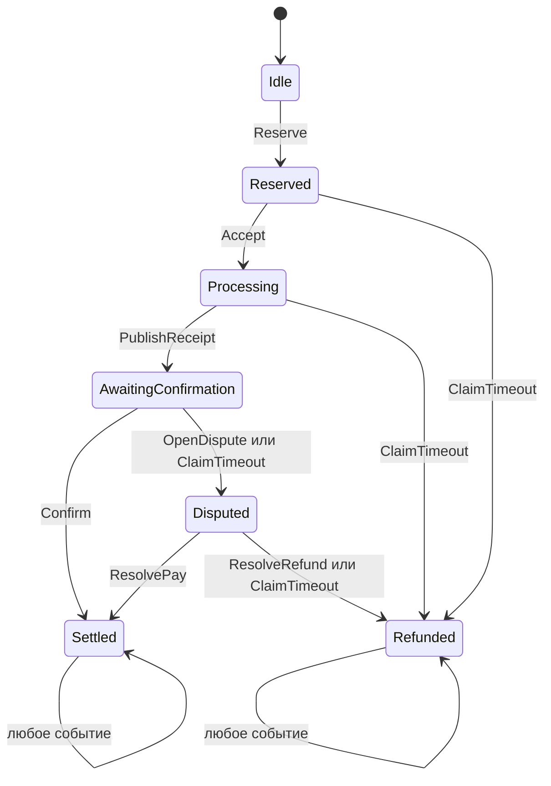

# Автоматная модель смарт-контракта оплаты запросов к нейросетевому сервису

## 1. Постановка задачи

В работе рассматривается контракт оплаты одного запроса к языковой модели. Пользователь резервирует средства, провайдер выполняет запрос, после чего стороны завершают расчёт либо разрешают спор. На результат влияют действия участников, задержки и доступность операций завершения.

Контракт представляется детерминированным автоматом, а внешняя среда — управляющим автоматом. Их совместное поведение исследуется с помощью сплетения автоматов и анализа минимальных подавтоматов [1].

**Цель:** определить условия завершения расчётов и найти сценарии, приводящие систему в замкнутую область поведения с заблокированными средствами.

Задачи работы:

1. Формализовать правила контракта и ограничения конечной модели.
2. Построить детерминированный автомат-определитель, затем автоматы Мура и Мили.
3. Описать управляющие автоматы среды и их сплетение с контрактом.
4. Исследовать достижимость, замкнутые компоненты, денежные инварианты и условия завершения.
5. Построить геометрические образы и сопоставить изображения с результатами анализа графов.
6. Реализовать модель и анализатор на C# и провести эксперименты с различными сценариями среды.

## 2. Предметная область

Платные нейросетевые сервисы связывают оплату с запросами, ответами и учётом использования. В системе 0G Compute [5], например, используются счета провайдеров и отложенные пакетные расчёты за запросы.

Рассматриваемый контракт задаёт расчёт для одного запроса: резервирование максимальной стоимости, публикацию квитанции, подтверждение результата, арбитраж и возврат средств по истечении срока.

Публикация ответа и его получение пользователем могут происходить в разное время. Сообщения могут задерживаться или поступать повторно, а участники — прекращать взаимодействие. Анализ этих ситуаций позволяет определить условия завершения расчётов и возникновения блокировок.

## 3. Границы и участники модели

### 3.1. Участники

| Участник | Действия и ответственность |
| --- | --- |
| Пользователь | Резервирует оплату, подтверждает получение результата или открывает спор |
| Провайдер | Принимает и выполняет запрос, публикует квитанцию о результате |
| Арбитр | По заданным правилам рассматривает спор и выбирает оплату либо возврат |
| Инициатор завершения | Любой участник или внешний наблюдатель, вызывающий разрешённое действие после истечения срока |
| Источник времени | Формирует достоверное событие достижения срока; не распоряжается средствами |

Инициатором завершения может быть любой участник или внешний наблюдатель. В сценариях среды отдельно задаётся, вызывает ли он разрешённую операцию.

### 3.2. Допущения модели

- Рассматривается один запрос между фиксированными пользователем и провайдером; арбитр выбирается до резервирования.
- Фиксируются идентификатор запроса, модель и правила расчёта. Параллельные запросы и смена провайдера остаются за границами первой версии.
- Запрос и ответ обрабатываются вне блокчейна. В модели хранятся их идентификаторы, хеши и признаки проверок.
- Ответ рассматривается как единый результат. Потоковая выдача и оплата частичного ответа не моделируются.
- Деньги учитываются в целых условных единицах. Комиссии, валютные курсы и реальные переводы не моделируются.
- Проверки подписей и соответствия квитанции представлены конечными признаками «допустимо / недопустимо». Криптографическая реализация не входит в первую версию.
- Решение уполномоченного арбитра считается достоверным. Его недоступность рассматривается как отдельный сценарий.
- Генерация ответа представляется событием среды и воспроизводится локально.

## 4. Спецификация расчётов

### 4.1. Бюджет и квитанция

До начала исполнения стороны фиксируют цену одного токена `p > 0`, максимальное суммарное число входных и выходных токенов `U > 0` и идентификатор модели с правилами токенизации. Для простоты используется единая цена входных и выходных токенов.

Пользователь резервирует максимальную стоимость:

$$
R = pU.
$$

Квитанция провайдера содержит идентификатор запроса, идентификатор модели, хеш согласованных условий, хеш запроса, хеш ответа, заявленный объём `u` и стоимость `C`. Допустимы значения:

$$
1 \leq u \leq U, \qquad C = pu \leq R.
$$

Квитанция должна соответствовать текущему запросу и согласованным условиям и иметь допустимое подтверждение авторства провайдера. Несоответствие объёма, стоимости, идентификаторов или подтверждения авторства делает событие недопустимым.

При оплате `C` перечисляется провайдеру, а `R - C` возвращается пользователю. При полном возврате пользователь получает `R`, провайдер — `0`. В первой версии нет частичного удовлетворения спора и залога провайдера.

Подпись используется для проверки авторства квитанции. Пользователь подтверждает получение ответа и принимает заявленный объём использования либо открывает спор. При споре решение о расчёте принимает арбитр. Проверка содержания ответа и фактического числа токенов относится к процедуре арбитража; в автомат поступает готовый вердикт.

### 4.2. Правила завершения

1. Резервирование открывает срок принятия запроса провайдером.
2. Принятие до истечения срока открывает срок выполнения запроса.
3. Публикация допустимой квитанции до истечения срока выполнения открывает срок подтверждения пользователем.
4. Подтверждение квитанции пользователем в пределах срока завершает расчёт оплатой.
5. Пользователь может открыть спор в пределах срока подтверждения. При отсутствии подтверждения после срока любой инициатор может отдельным действием открыть спор по тайм-ауту.
6. Открытие спора запускает срок арбитража. До его истечения арбитр выбирает оплату по квитанции либо полный возврат.
7. После истечения срока принятия, выполнения или арбитража любой инициатор может отдельным действием выполнить полный возврат.
8. При достижении срока обычные действия соответствующего этапа становятся недопустимыми; разрешаются действия по тайм-ауту.
9. Завершённый запрос не открывается повторно. Повторные сообщения не должны изменять итоговое распределение средств.

При недоступности арбитра приоритет отдаётся возврату резерва пользователю. В этом случае провайдер может остаться без оплаты выполненной работы.

## 5. Детерминированный автомат контракта

### 5.1. Этапы и полное состояние

| Этап `q` | Смысл |
| --- | --- |
| `Idle` | Средства ещё не зарезервированы |
| `Reserved` | Резерв создан, ожидается принятие запроса |
| `Processing` | Запрос принят, ожидается квитанция о результате |
| `AwaitingConfirmation` | Квитанция опубликована, ожидается решение пользователя |
| `Disputed` | Открыт спор, ожидается вердикт или истечение срока |
| `Settled` | Провайдеру начислена стоимость, пользователю возвращён остаток |
| `Refunded` | Пользователю возвращён весь резерв |

Полное состояние автомата включает этап, признак истечения срока текущего этапа, принятую квитанцию и распределение средств. Условия запроса фиксируются параметрами отдельного эксперимента.

Значения параметров выбираются из конечных областей. Начальная конфигурация: `p = 1`, `U = 2`, допустимый объём `u` равен `1` или `2`. В ней представлены полная оплата и оплата с возвратом части резерва. Другие значения задаются отдельными конфигурациями экспериментов.

Идентификаторы, хеши и подписи представляются классами «соответствует / не соответствует». Такое представление сохраняет условия переходов и позволяет задать конечный алфавит событий.

### 5.2. Время и события

В каждом ожидающем этапе время абстрагируется двумя значениями: `BeforeDeadline` и `DeadlineReached`. При входе в новый ожидающий этап устанавливается `BeforeDeadline`. Достоверное событие `DeadlineReached` переводит временной признак в достигнутый; повторное такое событие его не меняет. В терминальных этапах активного срока нет.

Событие времени меняет доступность операций. Для возврата средств или открытия спора после истечения срока требуется отдельное действие `ClaimTimeout`. Временная абстракция учитывает положение события относительно срока.

### 5.3. Переходы

В таблице перечислены переходы, меняющие этап. Каждое действие проверяет роль отправителя, соответствие запросу и допустимость данных. Обычные действия ожидающего этапа разрешены только при `BeforeDeadline`; действия по тайм-ауту — только при `DeadlineReached`.

| Текущий этап | Событие | Отправитель и дополнительное условие | Следующий этап и действие |
| --- | --- | --- | --- |
| `Idle` | `Reserve` | Пользователь, допустимые условия и сумма `R` | `Reserved`, создать резерв |
| `Reserved` | `Accept` | Провайдер | `Processing` |
| `Reserved` | `ClaimTimeout` | Любой инициатор, срок достигнут | `Refunded`, вернуть `R` |
| `Processing` | `PublishReceipt` | Провайдер, допустимая квитанция | `AwaitingConfirmation`, сохранить квитанцию |
| `Processing` | `ClaimTimeout` | Любой инициатор, срок достигнут | `Refunded`, вернуть `R` |
| `AwaitingConfirmation` | `Confirm` | Пользователь, подтверждение сохранённой квитанции | `Settled`, начислить `C` и вернуть `R - C` |
| `AwaitingConfirmation` | `OpenDispute` | Пользователь, спор по сохранённой квитанции | `Disputed` |
| `AwaitingConfirmation` | `ClaimTimeout` | Любой инициатор, срок достигнут | `Disputed`, открыть спор по тайм-ауту |
| `Disputed` | `ResolvePay` | Арбитр, вердикт об оплате сохранённой квитанции | `Settled`, начислить `C` и вернуть `R - C` |
| `Disputed` | `ResolveRefund` | Арбитр, вердикт о возврате | `Refunded`, вернуть `R` |
| `Disputed` | `ClaimTimeout` | Любой инициатор, срок достигнут | `Refunded`, вернуть `R` |

Переход `DeadlineReached` меняет только временной признак ожидающего этапа. Событие `Wait` ничего не меняет. Любое событие с невыполненными условиями, неверной ролью или неподходящим этапом оставляет полное состояние и денежный учёт без изменений и записывается в журнал как отклонённое. В `Settled` и `Refunded` все события оставляют состояние неизменным.

Эти правила задают полную детерминированную функцию переходов: для каждой пары «состояние — входной символ» определён единственный результат. При совпадении действий участников по времени их порядок задаётся входным словом. Если действие совпало с достижением срока, сначала обрабатывается событие времени: действие относится к достигнутому сроку. Среда должна соблюдать этот порядок.

Ниже показаны только переходы между этапами. Временные признаки, параметры квитанции и петли отклонённых событий в схеме не раскрыты.



### 5.4. Автоматы-определитель, Мура и Мили

Автомат-определитель задаётся как

$$
\mathcal A = (I,S,\delta,s_0,F),
$$

где `I` — конечный алфавит событий с абстрактными параметрами; `S` — множество полных состояний; `s₀` — исходное состояние этапа `Idle`; `F` — состояния с этапами `Settled` или `Refunded`.

Для автомата Мура выход определяется по принадлежности `F`:

$$
g(s)=\begin{cases}1,&s\in F,\\0,&s\notin F.\end{cases}
$$

Выход автомата Мили, согласно построению из задания:

$$
\tau(a,s)=g(\delta(a,s)).
$$

Выход `1` означает завершение расчётов, включая возврат средств. Принятое действие, причина отклонения события и движение средств фиксируются в журнале исполнения.

## 6. Среда и сплетение автоматов

Управляющий автомат среды задаётся как `E = (Q, η, λ, e₀)`, где `Q` — конечное множество состояний, `η` — переход среды, `λ(e)` — событие, выдаваемое контракту. Для первого варианта среда автономна и воспроизводит заранее заданный сценарий. Конечный префикс событий с последующим повторением `Wait` представляется конечным автоматом.

По определению сплетения [2] совместное состояние — пара `(e,s)`, а переход имеет вид:

$$
H(e,s)=\bigl(\eta(e),\delta(\lambda(e),s)\bigr).
$$

На шаге используется выход текущего состояния среды. Выход совместной системы равен `τ(λ(e),s)`. Для каждого сценария строится достижимая часть произведения из `(e₀,s₀)`.

Время включается в сценарий явно. Если этап остаётся активным, среда за конечное число шагов формирует событие достижения его срока. Последующее ожидание без `ClaimTimeout` моделирует отсутствие внешнего действия при уже истёкшем сроке.

Граф контракта содержит переходы при всех входных событиях. Сплетение ограничивает их последовательностью событий выбранной среды. Поэтому достижимость завершения исследуется как для самого контракта, так и для каждого совместного автомата.

## 7. Проверяемые свойства

### 7.1. Сохранение средств и допустимость оплаты

После успешного резервирования вводятся величины: остаток в контракте `B`, начислено провайдеру `P`, возвращено пользователю `V`.

$$
B + P + V = R, \qquad B,P,V \geq 0.
$$

До завершения ожидается распределение `(R,0,0)`. После оплаты — `(0,C,R-C)`, после полного возврата — `(0,0,R)`.

Проверяемые свойства:

- сумма оплаты не превышает резерв;
- оплата разрешается только по сохранённой допустимой квитанции и подтверждению пользователя либо вердикту арбитра;
- отклонённое событие не изменяет денежный учёт;
- повторные сообщения после завершения не вызывают повторного начисления или возврата;
- решения чужой роли и квитанции другого запроса не принимаются.

### 7.2. Критические минимальные подавтоматы

В используемой теории минимальный непустой замкнутый подавтомат конечного полного автомата соответствует компоненте сильной связности без исходящих переходов [4]. Это отличается от минимизации числа состояний по эквивалентности.

Терминальные состояния `Settled` и `Refunded` образуют замкнутые подавтоматы с завершёнными расчётами и относятся к нормальным исходам.

Критической считается достижимая замкнутая компонента совместной системы, во всех состояниях которой расчёты не завершены и `B > 0`. Для найденной компоненты фиксируются состояния, переходы и последовательность событий, ведущая в неё из начальной пары.

Один из исследуемых сценариев — прекращение действий участников после резервирования: срок истёк, но `ClaimTimeout` не вызывается. При анализе устанавливается причина блокировки: отсутствие нужного воздействия среды или недостижимость возврата даже при наличии инициатора.

### 7.3. Условия завершения

Проверяется гипотеза: если время продвигается, разрешённые действия завершения в итоге инициируются, а арбитраж заканчивается вердиктом или резервным возвратом, то расчёты завершаются за конечное число шагов.

Для каждой среды задаются последовательность действий и условия их появления. Сначала определяются достижимость завершения и кратчайшие пути к нему. Повторения `Wait` и отклонённых событий могут неограниченно увеличивать длину исполнения, поэтому максимальное время завершения оценивается только при ограничении числа таких повторений.

## 8. Геометрические образы

Для геометрического образа используется кодирование из [3]: входные символы нумеруются числами `1,…,m`, выходные — `1,2`, где `m = |I|`.

Для хронологически прочитанных символов `a₀,…,aₖ₋₁` и полученных выходов `b₀,…,bₖ₋₁` вычисляются координаты:

$$
X_k=\sum_{i=0}^{k-1} c_I(a_i)(m+1)^{-i},
\qquad
Y_k=\sum_{i=0}^{k-1} c_O(b_i)3^{-i}.
$$

Здесь `a₀` — первое обработанное событие. Координаты лежат в `[1,m+1) × [1,3)`.

Для вычислений выбирается конечное приближение по словам ограниченной длины. Полный перебор имеет размер `m^k`; глубина и предел числа точек задаются в конфигурации. Отдельно строятся изображения траекторий выбранных сценариев.

Компоненты определяются по графу переходов, после чего точки раскрашиваются по достигнутому состоянию или компоненте. Цветовая маркировка позволяет различать внутренние состояния с одинаковым бинарным выходом.

## 9. План реализации на C#/.NET

### 9.1. Техническая основа

Для реализации выбраны C# и .NET 10 [6]. Приложение будет иметь консольный интерфейс для выбора конфигурации, запуска сценариев и экспорта результатов.

Модель, обход графов и экспорт будут реализованы средствами стандартной библиотеки .NET. Планируемая структура:

```text
src/NeuralInferenceContract/
    Model/       Состояния, события, квитанция и правила переходов
    Automata/    Представления автоматов и построение сплетения
    Analysis/    Достижимость, компоненты и проверка свойств
    Scenarios/   Конечные управляющие автоматы среды
    Export/      Таблицы, графы и геометрические изображения
tests/NeuralInferenceContract.Tests/
    Проверки денежных инвариантов и существенных сценариев
```

### 9.2. Этапы и критерии готовности

| Этап | Работа | Проверяемый результат |
| --- | --- | --- |
| 1. Спецификация | Описать роли, арбитражную политику, события и ограничения | Однозначно определены переходы, сроки и распределение средств |
| 2. Модель контракта | Реализовать состояния и чистую функцию перехода | Любая пара состояния и события даёт единственный результат; сохраняются денежные инварианты |
| 3. Автоматы и среды | Добавить выходы Мура/Мили, сценарии и сплетение | Трассы продукта совпадают с пошаговым исполнением выдаваемых средой событий |
| 4. Анализ графов | Построить достижимые графы, обход в ширину и поиск сильных компонент | Для найденных компонент указаны замкнутость, критичность и воспроизводимые пути |
| 5. Изображения и экспорт | Выгрузить CSV, графы Mermaid и геометрические точки в SVG | Каждый результат связан с конфигурацией, сценарием и глубиной построения |
| 6. Эксперименты и отчёт | Выполнить сценарии, сопоставить среды, дополнить документ | Есть фактические результаты, интерпретация и границы выводов |

Правила переходов будут отделены от вывода в консоль. Для денежных операций используются целые числа с проверкой переполнения; некорректные параметры конфигурации отклоняются до построения графа. Логика обхода графа работает с неизменяемыми ключами полных состояний.

Тестирование охватывает сохранение средств на всех достижимых переходах конечной конфигурации, повторные сообщения, ограничения ролей, граничные сроки и соответствие сплетения пошаговому исполнению двух автоматов.

### 9.3. Планируемые эксперименты

| Сценарий | События среды | Проверяемое поведение |
| --- | --- | --- |
| Успешное выполнение | Резерв, принятие, квитанция, подтверждение | Оплата один раз и возврат остатка |
| Провайдер не принял запрос | Резерв, истечение срока, вызов завершения | Достижимость полного возврата |
| Провайдер не выдал результат | Принятие, истечение срока выполнения, вызов завершения | Возврат без оплаты |
| Пользователь молчит | Квитанция, срок подтверждения, открытие спора по тайм-ауту | Зависимость результата от арбитра и инициатора |
| Спор разрешён | Квитанция, спор, один из двух вердиктов | Соответствие распределения средств вердикту |
| Арбитр недоступен | Спор, срок арбитража, вызов завершения | Достижимость резервного возврата |
| Нет инициатора завершения | Достигнутый срок и дальнейшее бездействие | Критические компоненты конкретного сплетения |
| Повтор или нарушение условий | Дубликаты, неверная роль, неподходящая квитанция | Сохранность учёта и отклонение действий |

## 10. Дополнительный вероятностный анализ

После детерминированного анализа планируется рассмотреть вероятности попадания в минимальные подавтоматы и соответствующие дендрограммы [4]. Для этого отдельно задаётся вероятностный закон входных событий. Слова рассматриваются до первого попадания в целевую компоненту, что исключает повторный учёт продолжений одного пути.

При независимых равновероятных входных битах вероятность слова длины `ℓ` равна `2^(-ℓ)`. Для событий пользователей и провайдера вероятности определяются выбранной моделью среды.

## 11. Источники

[Теоретические материалы по автоматам и смарт-контрактам](https://drive.google.com/drive/folders/1LQsEanBxNsDow68J0PSqAvq02Ex95lZy?usp=sharing).

1. Тяпаев Л. Б. «Автоматные модели смарт-контрактов». Индивидуальное задание от 1 октября 2026 г. Файл «Индивидуальное задание.pdf», с. 1–2.
2. «Псевдослучайные генераторы. Сплетение автоматов». Материалы от 23 декабря 2025 г. Файл «Сплетения.pdf», с. 32–35: определения сплетения отображений и автоматов.
3. Тяпаев Л. Б. «Геометрические образы автоматов». Материалы от 31 октября 2026 г. Файл «Геом_образы_автоматов.pdf», с. 1–3: кодирование слов и различие геометрических представлений.
4. Тяпаев Л. Б. «Моделирование случайной величины». Файл «Моделирование случайной величины.pdf», с. 5–6: минимальные подавтоматы; с. 14–19: префиксные коды и вероятности путей.
5. [0G Documentation. Inference](https://docs.0g.ai/developer-hub/building-on-0g/compute-network/inference). Практический пример нейросетевого сервиса со счетами провайдеров и пакетными расчётами. Дата обращения: 7 ноября 2026 г.
6. [Microsoft Learn. dotnet new](https://learn.microsoft.com/en-us/dotnet/core/tools/dotnet-new). Инструменты создания проектов .NET. Дата обращения: 7 ноября 2026 г.
